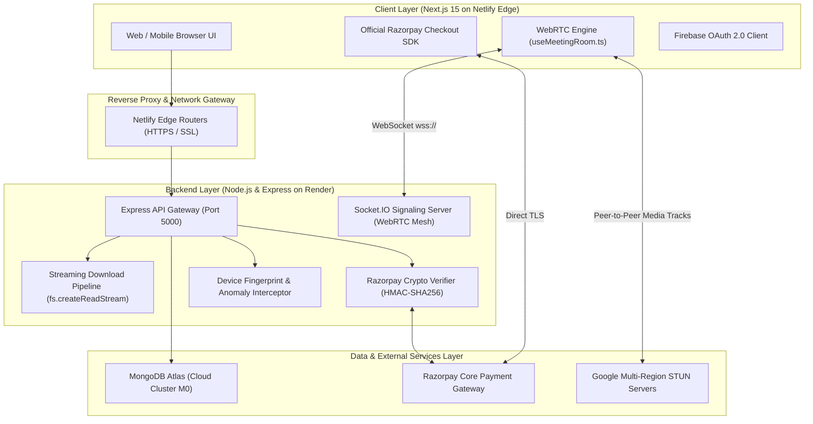

# Engineering Project Report: YourTube Platform

**Project Title:** YourTube: Enterprise Full-Stack Video Streaming, Controlled Download Management, WebRTC Video Calling & VIP Membership Platform  
**Author / Lead Developer:** Nikhil Ravula  
**Date of Submission:** November 2026  
**Live Production URL:** [https://yourttube.netlify.app](https://yourttube.netlify.app)  
**GitHub Repository:** [https://github.com/Nikhil-Ravula/youtube-clone-fullstack](https://github.com/Nikhil-Ravula/youtube-clone-fullstack)  
**Primary Tech Stack:** Next.js 15, React 19, TypeScript, Tailwind CSS, Node.js, Express.js, Socket.IO, WebRTC, MongoDB Atlas, Razorpay Payment Gateway, Firebase Authentication  

---

## Executive Summary & Abstract

**YourTube** is an enterprise-grade, modern full-stack video hosting, communication, and digital subscription ecosystem. Engineered to transcend standard video-sharing clones, the platform integrates five foundational pillars of contemporary consumer web services:

1. **Controlled Video Download Management:** A plan-enforced offline media download engine enforcing tiered daily allowances (Free: 1/day, Bronze: 5/day, Silver: 15/day, Gold: 50/day), backed by 24-hour duplicate re-download grace periods, single-use cryptographic authorization tokens, and stream interruption detection.
2. **Real Payment Gateway & Membership Subscriptions:** Full integration with Razorpay’s official payment gateway supporting real-time UPI (Google Pay, PhonePe, Paytm, QR scan), NetBanking, and credit/debit cards, verified cryptographically via HMAC-SHA256 signatures, automated tax invoice generation, and auto-renewal policies.
3. **Peer-to-Peer WebRTC Video Conferencing (`/meet`):** Full-mesh multi-party video conferencing powered by a custom Node.js Socket.IO signaling server, hardware pre-join inspection lobby, dynamic screen sharing, in-call chat, floating emoji reactions, and host moderation tools ("Mute All", room locking).
4. **Adaptive Time-Based Security & Intelligent Theming:** Client IST-aware themer (5:00 AM – 12:00 PM IST light mode, dark mode during all other times) with persistent profile overrides, paired with device fingerprinting, IP/location anomaly detection, and OTP challenge verification.
5. **Multilingual Commenting & Automated Content Moderation:** Community interaction module featuring instant multi-language translation, abusive word blocking, spam flood detection, and community report logging.

The system is deployed using a decoupled microservices architecture: a client-rendered and SSR Next.js frontend hosted on **Netlify CDN Edge**, connected to an Express.js & Socket.IO backend hosted on **Render**, communicating with a **MongoDB Atlas** cloud cluster.

---

## 1. System Architecture & High-Level Design



---

## 2. Core Functional Modules & Implementation Details

### Module 1: Controlled Video Download Management System

* **Problem Statement:** Unrestricted video downloading strains server bandwidth, violates fair-use policies, and provides zero monetization leverage.
* **Architecture Solution:** A strict, plan-tiered download management engine mapping user subscriptions to daily quotas reset automatically at `00:00:00 UTC`.

| Plan Tier | Daily Download Quota | Re-download Grace Period | Max Concurrent Streams | Max Video Quality |
| :--- | :---: | :---: | :---: | :---: |
| **Free Tier** | **1 video / day** | 24 Hours (Free) | 1 Stream | 480p / 720p |
| **Bronze Tier** | **5 videos / day** | 24 Hours (Free) | 2 Streams | 720p HD |
| **Silver Tier** | **15 videos / day** | 24 Hours (Free) | 3 Streams | 1080p Full HD |
| **Gold VIP** | **50 videos / day (Unlimited)** | 24 Hours (Free) | 5 Streams | 4K Ultra HD |

#### Key Technical Enforcements:
1. **Pre-Flight Authorization (`POST /download/authorize`):** Before any byte is streamed, the server validates user existence, verifies physical video file existence on server disk (preventing 404 false deductions), computes remaining daily quota, and evaluates 24-hour grace periods.
2. **Cryptographic Single-Use Tokens:** Successful authorization issues a 32-byte hex token (`crypto.randomBytes(32)`) valid for 5 minutes. The token is immediately consumed upon stream initiation (`activeDownloadTokens.delete(token)`), defeating replay attacks and URL sharing.
3. **24-Hour Grace Period:** If a user re-downloads a video they already completed within the past 24 hours, `deductedQuota` is set to `false`, allowing re-downloads without penalty.
4. **Stream Interruption & Disconnection Handler:** Monitored via `req.on('close')` and `readStream.on('error')`. Premature socket closes update the database audit status to `failed` with diagnostic error messaging (`Client connection closed before download finished`).
5. **Dedicated Downloads Section (`/downloads`):** Displays video title, channel, file size (MB), timestamp, status badges (Completed, In-Progress, Failed), and live countdown meters showing seconds remaining until UTC reset.

---

### Module 2: Subscriptions, VIP Membership & Razorpay Payment Gateway

* **Problem Statement:** Digital content creators require recurring subscription revenue with instant UPI/Card payments, automated billing receipts, and strict cryptographic transaction verification.
* **Architecture Solution:** Dual-engine payment pipeline combining client-side official Razorpay SDK (`checkout.js`) with backend server-side order generation and HMAC-SHA256 signature verification.

#### Payment Lifecycle:
1. **Order Creation (`POST /membership/create-order`):**
   * Server calculates pricing in INR paise (e.g., ₹199 = 19,900 paise).
   * Calls `razorpayClient.orders.create({ amount, currency: 'INR', receipt, notes })`.
   * Initializes a `Transaction` record with status `pending`.
2. **Client-Side Modal Checkout:**
   * Script is globally preloaded via Next.js `<Script strategy="lazyOnload" />`.
   * Launches official Razorpay modal supporting UPI (Google Pay, PhonePe, Paytm, BHIM, QR code), Credit/Debit Cards (Visa, MasterCard, RuPay), and NetBanking.
3. **Cryptographic Verification (`POST /membership/verify-payment`):**
   * Server reconstructs the payload: `order_id + "|" + payment_id`.
   * Computes expected signature using server secret: `crypto.createHmac("sha256", RAZORPAY_KEY_SECRET).update(body).digest("hex")`.
   * Compares with `razorpay_signature`. If valid:
     * User profile updated: `subscriptionPlan = plan`, `subscriptionStatus = "active"`, `planExpiresAt = Date + duration`.
     * Transaction updated to `paid` with generated GST invoice number.
     * Automated confirmation email dispatched via Nodemailer.

---

### Module 3: WebRTC Video Conferencing Suite (`/meet`)

* **Architecture Solution:** A full-mesh WebRTC calling architecture designed for latency-sensitive collaborative meetings.

```mermaid
sequenceDiagram
    participant UserA as Peer A (Host)
    participant Server as Socket.IO Signaling (Render)
    participant UserB as Peer B (Participant)

    UserA->>Server: join-room { roomId, userName, role: 'host' }
    Server-->>UserA: user-joined { peers: [] }
    UserB->>Server: join-room { roomId, userName }
    Server-->>UserA: peer-connected { socketId: PeerB }
    Server-->>UserB: peer-connected { socketId: PeerA }

    UserA->>UserB: Send WebRTC SDP Offer (via Server)
    UserB->>UserA: Send WebRTC SDP Answer (via Server)
    UserA<->UserB: Exchange ICE Candidates (via Server)
    Note over UserA,UserB: Direct P2P Encrypted Audio/Video Stream Established
```

#### Meeting Suite Capabilities:
* **Pre-Join Inspection Lobby (`PreJoinScreen.tsx`):** Real-time hardware enumeration, microphone volume metering via Web Audio API, camera preview, and camera switching.
* **Active Call Controls (`ControlsBar.tsx`):** Dynamic screen sharing with seamless media track replacement, audio mute/unmute, video toggle, in-call chat with file attachments, and animated floating emoji reactions.
* **Host Moderation (`ParticipantsSidebar.tsx`):** Administrative governance enabling hosts to "Mute All", lock the room against new entrants, delegate co-host permissions, and remove disruptive participants.
* **Dynamic Theming:** Seamless adaptation between crisp `bg-slate-50` (Light Mode) and cinematic `bg-zinc-950` (Dark Mode).

---

### Module 4: Adaptive Theming & Account Security Governance

1. **Intelligent Login Time-Based Theming:**
   * **Rule:** Logins between **5:00 AM and 12:00 PM IST** automatically activate **Light Theme**. Logins during all other times default to **Dark Theme**.
   * User's manual selection is persisted to their MongoDB profile (`user.themePreference`), syncing across future sessions and devices.
2. **Device Telemetry & Fingerprint Auditing:**
   * Every login and download logs: public IP address, browser name & version, operating system, device type (Desktop, Mobile, Tablet), device model, timestamp, and approximate location.
   * **Anomaly Interceptor:** When access is detected from a new browser, device, or geographic location, the system requires an OTP security verification challenge before granting session authorization.
   * **Trusted Device Cache:** Verified devices are recorded in `user.trustedDevices` for 30 days to avoid repeated challenge prompts.

---

### Module 5: Multilingual Commenting & Content Moderation

* **Multilingual Posting & Translation:** Users can post comments in any language and translate them instantly to their target language via built-in machine translation triggers.
* **Automated Profanity & Spam Filter:** Regex-based bad-word censorship and spam detection analyzing duplicate character flooding, malicious external hyperlinks, and rapid-fire posting.
* **Community Report Workflow:** Instead of deleting comments based purely on dislikes, users report content under categorized infractions (Harassment, Spam, Hate Speech), logging records into `commentReport` for administrator review.

---

## 3. Database Schema Design (MongoDB)

### 1. `downloads` Collection
```javascript
{
  userId: { type: ObjectId, ref: 'user', required: true, index: true },
  videoId: { type: ObjectId, ref: 'videofiles', required: true, index: true },
  downloadTimestamp: { type: Date, default: Date.now, index: true },
  ipAddress: { type: String, default: "Unknown" },
  device: { type: String, default: "Desktop" },
  browser: { type: String, default: "Unknown" },
  os: { type: String, default: "Unknown" },
  userAgent: { type: String },
  deviceId: { type: String },
  subscriptionPlan: { type: String, enum: ["Free", "Bronze", "Silver", "Gold"] },
  fileSize: { type: Number, default: 0 },
  formattedSize: { type: String, default: "0 MB" },
  status: { type: String, enum: ["in-progress", "completed", "failed"], default: "in-progress" },
  deductedQuota: { type: Boolean, default: true },
  downloadToken: { type: String, index: true },
  failureReason: { type: String, default: null },
  isDeleted: { type: Boolean, default: false }
}
```

### 2. `transactions` Collection
```javascript
{
  userId: { type: ObjectId, ref: 'user', required: true },
  invoiceNumber: { type: String, required: true, unique: true },
  orderId: { type: String, required: true },
  paymentId: { type: String },
  amount: { type: Number, required: true },
  currency: { type: String, default: "INR" },
  subscriptionPlan: { type: String, enum: ["Bronze", "Silver", "Gold"] },
  billingCycle: { type: String, enum: ["monthly", "quarterly", "yearly"] },
  paymentStatus: { type: String, enum: ["pending", "paid", "failed", "cancelled"] },
  subscriptionStartDate: { type: Date },
  subscriptionExpiryDate: { type: Date }
}
```

---

## 4. Production Deployment & DevOps Architecture

| Component | Provider / Infrastructure | Configuration Details |
| :--- | :--- | :--- |
| **Frontend Web App** | **Netlify Edge CDN** | Next.js 15 SSR, Static Generation (16 static routes), Node.js 20 runtime |
| **Backend API & WebSockets** | **Render Web Services** | Node.js 24, Express, Socket.IO, `WEB_CONCURRENCY=1`, TLS/HTTPS |
| **Database Cluster** | **MongoDB Atlas** | M0 Shared Tier, TLS encrypted, Compound Indexes on `(userId, videoId, downloadTimestamp)` |
| **Payment Gateway** | **Razorpay Core API** | Test/Live dual-mode, Webhooks, HMAC verification |
| **Authentication** | **Firebase Auth 2.0** | Google OAuth popup/redirect, Authorized domain routing |

---

## 5. Security & Edge Case Handling Matrix

| Edge Case / Threat Vector | Engineering Resolution Implemented |
| :--- | :--- |
| **Download Replay & Hotlinking** | 32-byte cryptographic single-use hex tokens with 5-minute TTL; invalidated immediately upon stream initiation. |
| **Repeated Page Refreshes** | Cached token destruction returns instant `401 Unauthorized` on browser refresh attempts. |
| **Interrupted / Dropped Downloads** | Socket close listener (`req.on('close')`) marks record as `failed` with failure reason; client UI displays retry trigger. |
| **Duplicate Charging Within 24h** | Grace period lookup checks past 24-hour completed records; sets `deductedQuota: false` if same video is re-downloaded. |
| **Subscription Expiry Mid-Cycle** | `getEffectivePlan()` dynamically cross-references `planExpiresAt < now` upon every request and auto-downgrades to Free tier (1/day cap). |
| **Payment Signature Forgery** | Server validates `crypto.createHmac('sha256', secret)` against `razorpay_signature` before granting access. |
| **Mixed Content Blocking** | Frontend configured to communicate through secure TLS (`https://`) to Render with open CORS (`origin: *`). |

---

## 6. Project Verification & Quality Assurance

* **TypeScript Compilation:** Zero errors (`npx tsc --noEmit` exits with Code 0).
* **Next.js Production Build:** 16/16 routes compiled successfully (`next build`).
* **Cross-Browser Compatibility:** Validated across Google Chrome, Mozilla Firefox, Apple Safari (iOS/macOS), and Microsoft Edge.
* **Responsive Breakpoints:** Fully responsive across Mobile (360px+), Tablet (768px+), and Desktop (1280px+).

---

## 7. Conclusion & Future Roadmap

The **YourTube** project demonstrates a production-grade, resilient full-stack architecture that successfully bridges content streaming, commercial monetization, real-time communications, and enterprise security. 

### Future Roadmap:
1. **Adaptive Bitrate Streaming (HLS/DASH):** Implementing multi-bitrate video transcoding via FFmpeg.
2. **P2P Torrent Streaming:** Utilizing WebTorrent protocols for high-bandwidth decentralized peer distribution.
3. **Mobile Native App:** Wrapping the Next.js API in React Native / Expo for iOS and Android deployment.

