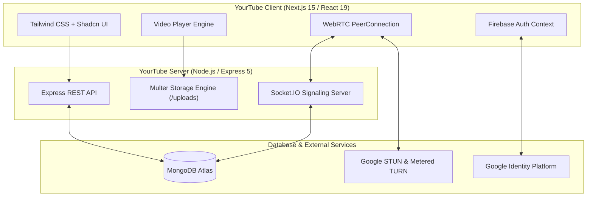

# 🎥 YourTube — Full-Stack Video Sharing & Real-Time Video Conferencing Platform

[](https://nextjs.org/)
[](https://react.dev/)
[](https://nodejs.org/)
[](https://expressjs.com/)
[](https://www.mongodb.com/)
[](https://socket.io/)
[](https://webrtc.org/)
[](https://firebase.google.com/)
[](https://tailwindcss.com/)
[](https://www.typescriptlang.org/)

**YourTube** is a modern, high-performance multimedia platform that unites the core experiences of **YouTube** (video sharing, adaptive streaming, channels, subscriptions, watch history, and comments) and **Google Meet** (multi-peer WebRTC video conferencing, screen sharing, in-call chat, and reactions) into a single, cohesive full-stack web application.

---

## 📑 Table of Contents
- [✨ Key Features](#-key-features)
  - [📺 YouTube Video Platform](#-youtube-video-platform)
  - [📥 Controlled Video Download Management](#-controlled-video-download-management)
  - [📹 Real-Time WebRTC Video Meetings](#-real-time-webrtc-video-meetings)
  - [🔐 Authentication & Privacy](#-authentication--privacy)
- [🏗️ System Architecture](#️-system-architecture)
- [🛠️ Technology Stack](#️-technology-stack)
- [📂 Repository Structure](#-repository-structure)
- [🚀 Getting Started](#-getting-started)
  - [Prerequisites](#prerequisites)
  - [1. Clone Repository](#1-clone-repository)
  - [2. Backend Setup](#2-backend-setup)
  - [3. Frontend Setup](#3-frontend-setup)
- [📡 REST API Reference](#-rest-api-reference)
- [⚡ WebRTC Signaling Protocol](#-webrtc-signaling-protocol)
- [⚙️ Environment Variables Reference](#️-environment-variables-reference)
- [🤝 Contributing](#-contributing)
- [📄 License](#-license)

---

## ✨ Key Features

### 📺 YouTube Video Platform
* **Fully Customized HTML5 Video Player**:
  * **No Browser Default Controls**: Completely bespoke, high-performance HTML5 video player interface with modern glassmorphism aesthetics.
  * **Interactive Playback Controls**: Draggable volume slider with smooth hover expansion, instant mute/unmute toggle, and variable playback speeds (`0.5×`, `0.75×`, `1×`, `1.25×`, `1.5×`, `1.75×`, `2×`).
  * **Seeking & Skipping**: Instant 10-second forward/backward jump buttons (`RotateCw`, `RotateCcw`) and configurable interval skipping.
  * **Viewing Modes**: Native Fullscreen (`f`), True Theater Mode (`t`) with full-width cinematic banner, and Picture-in-Picture (`p` / `i`) for background playback.
  * **Timeline Hover Frame Previews**: Dual-canvas frame scrubbing providing real-time hover previews of video frames before seeking along with timestamp tooltips.
  * **Dual Progress & Buffering Bar**: Visual indicators for buffer loading progress (`bufferedPercent`) and current playback time (`playedPercent`) with glowing scrubber handle.
  * **Dynamic Time Display**: Toggle between elapsed duration (`MM:SS`) and remaining duration (`-MM:SS`) by clicking on the time counter.
  * **Closed Captions & Subtitles**: Toggleable subtitles overlay (`c`) with customizable styling.
  * **Quality Selector & Tier Gating**: Adaptive quality switcher (`480p SD`, `720p HD`, `1080p FHD`, `4K Ultra HD`) linked to active user subscription tiers.
  * **Auto-Resume & Progress Persistence**: Remembers exact playback position locally and across devices via backend API (`/history/progress/:videoId`), auto-resumes with a floating notification and "Start over" option.
  * **Configurable Completion Tracking**: Videos automatically marked as completed in user history after reaching 90% watch threshold with visual thumbnail progress bars.
  * **Multi-Tab Concurrency Guard**: Inter-tab communication (`BroadcastChannel`) pauses playback automatically if the user starts watching another video in another tab or window.
  * **Autoplay Countdown**: Sleek 5-second animated circular countdown with Up Next thumbnail, title preview, "Cancel", and "Play Now" triggers.
  * **Auto-Hiding Controls**: Controls smoothly fade out after 2.8s of mouse inactivity during playback and instantly reappear on cursor motion, with cursor auto-hiding in fullscreen.
  * **Comprehensive Desktop Keyboard Shortcuts**:
    | Key Shortcut | Action |
    | :--- | :--- |
    | `Space` / `k` | Play / Pause |
    | `←` / `→` | Seek backward / forward 10 seconds |
    | `Shift` + `←` / `→` | Seek backward / forward 30 seconds |
    | `j` / `l` | Seek backward / forward 10 seconds |
    | `↑` / `↓` | Adjust volume up / down by 10% |
    | `m` | Mute / Unmute audio |
    | `f` | Toggle Fullscreen mode |
    | `t` | Toggle Theater mode |
    | `i` / `p` | Toggle Picture-in-Picture (PiP) |
    | `c` | Toggle Subtitles / Closed Captions |
    | `<` (Shift+,) / `>` (Shift+.) | Decrease / Increase playback speed |
    | `n` (Shift+N) | Skip to Next video |
    | `0` – `9` | Seek to 0% – 90% of video duration |
  * Create custom channels with names and descriptions.
  * Channel profile pages displaying all uploaded videos, banner placeholders, and live subscriber metrics.
* **Engagement & Social Systems**:
  * **Like / Dislike**: Real-time counter updates with optimistic UI updates.
  * **Advanced Multilingual Commenting & Moderation Suite**:
    * **Multilingual Posting & Instant Translation**: Post comments in any language with on-the-fly machine translation into user-selected preferred languages (English, Hindi, Spanish, French, German, Japanese, Telugu, Tamil, Arabic, Russian, and 100+ global languages) via built-in `🌐 Translate` toggle and "See original" switcher.
    * **Rich Comment Display**: Displays username, verified avatar, approximate user location (`📍 City, Country`), relative time with full UTC/IST hover timestamps, and `(edited)` status indicators.
    * **Reactions & Nested Threading**: Real-time Like/Dislike counters, collapsible threaded replies with vertical connector guides, and `@username` auto-mentions highlighting.
    * **15-Minute Edit Window & Soft-Delete Preservation**: Time-limited editing (15-minute window) to prevent post-discussion context shifting, edit history tracking, and soft-delete placeholders (*"[This comment was deleted by the author]"*) that keep child reply conversations intact.
    * **Multi-Criteria Sorting**: Sort comments by **Newest first**, **Top / Most liked**, **Most relevant** (engagement score based on likes and replies), and **Oldest first**.
    * **Automated Safety & Profanity Filtering**: Multi-language abusive word detection (English & Hindi/Hinglish slurs, leetspeak, and evasion patterns) that prevents hateful comments before publishing.
    * **Anti-Spam & Flood Prevention**: Detection and blocking of repeated special characters, excessive emoji flooding, identical duplicate comments, and malicious URLs / phishing links.
    * **Rate Limiting & Interactive CAPTCHA**: Sliding-window rate limiting protecting against rapid flooding (max 4 comments / 30s), dynamically prompting arithmetic CAPTCHA challenges when flooding is detected.
    * **Predefined Reporting & Admin Review Queue**: Report comments for *Spam*, *Harassment*, *Hate speech*, *Misinformation*, or *Malicious links*. Flags comments for administrator review without automatic deletion by dislikes, with duplicate report prevention per user.
  * **Subscriptions**: Subscribe/Unsubscribe to channels with automatic live subscriber updates.
* **Personalized Library**:
  * **Subscriptions Feed**: Dedicated feed showcasing videos exclusively from creators you follow.
  * **Watch Later**: One-click saving to your private Watch Later list.
  * **Watch History**: Automatic tracking and review of watched videos.
  * **Liked Videos**: Curated playlist of your favorited videos.
* **Exploration & Search**:
  * Live search bar querying video titles, descriptions, and uploader names.
  * Dynamic category filter tags for instant topic browsing.
* **Responsive Multi-Device UI**:
  * Collapsible desktop sidebar drawer and compact icon mode.
  * Native app-style bottom navigation bar (`MobileBottomNav`) optimized for smartphones and tablets.

---

### 📥 Controlled Video Download Management
* **Tiered Subscription Plans & Quotas**:
  * **Free**: 1 video download per day (480p SD).
  * **Bronze (₹199/mo)**: 5 video downloads per day (720p HD).
  * **Silver (₹499/mo)**: 15 video downloads per day (1080p FHD).
  * **Gold (₹999/mo)**: 50 video downloads per day (4K Ultra HD & unlimited capacity).
* **Pre-Download Authorization & Security**:
  * Verification of active subscription, daily remaining quota, and video file existence before generating secure streaming tokens.
  * Automatic fallback to Free tier upon subscription expiration.
* **Fair Use & 24-Hour Grace Period**:
  * Duplicate re-downloads of the same video within 24 hours do not consume daily quota, protecting against network drops and multi-device access.
* **Full Audit & Telemetry Logging**:
  * Persistent records storing user ID, video ID, timestamp, IP address, device type, browser, OS, file size, plan used, and stream completion status (`completed`, `failed`).
* **Dedicated Downloads & Offline Library**:
  * Dedicated `/downloads` page displaying all downloaded videos, thumbnail previews, file sizes, live daily quota meters, and UTC midnight reset countdowns.
  * Interactive Subscription Plan selector & upgrade modal.

---

### 💳 Comprehensive Subscription Management & Razorpay Integration
* **Four Progressively Enhanced Tiers**:
  * **Free**: Basic video access, 480p SD quality, 1 download/day, 30s preview on premium videos.
  * **Bronze Plus**: 720p HD streaming, 5 downloads/day, 3-minute preview on premium content, 2 registered devices.
  * **Silver Pro**: 1080p Full HD streaming, 15 downloads/day, 100% ad-free playback, offline downloads, priority CDN streaming, 4 devices.
  * **Gold VIP**: 4K Ultra HD & 60fps streaming, 50 downloads/day, completely ad-free, exclusive access to Premium Courses & Masterclasses, VIP badge, 10 simultaneous devices, 24/7 priority support.
* **Flexible Billing Cycles & Discounts**:
  * Monthly, Quarterly (15% savings), and Yearly (25% savings + 2 months free) billing terms.
* **Dedicated Subscription Dashboard (`/membership`)**:
  * Interactive plan comparison cards and side-by-side feature comparison table.
  * Live status monitor: active plan badge, remaining validity days/hours countdown, next renewal date, and auto-renewal toggle.
  * Complete billing history ledger with invoice numbers, amounts, payment IDs, dates, and status tags (`PAID`, `FAILED`, `CANCELLED`).
  * Modal view for official GST tax invoices and payment receipts with printable PDF formatting.
* **Secure Razorpay Test Payment Integration**:
  * Server-side order generation (`/membership/create-order`) and cryptographic HMAC-SHA256 signature verification (`/membership/verify-payment`).
  * Seamless handling of successful payments, failed transactions, cancelled checkouts, network interruptions, and duplicate payment replay prevention.
* **Automated Subscription Lifecycle & Expiry Guard**:
  * Premium content & HD quality gating activated exclusively upon verified payment.
  * Automatic downgrade to Free plan upon validity expiry, preserving all user channel uploads, playlists, liked videos, and watch history.
  * 1-click renewal cancellation that keeps active benefits active until the end of the paid billing period.
* **Instant Confirmation Emails**:
  * Automated email dispatch via Nodemailer immediately after purchase containing tax invoice numbers, transaction IDs, payment receipts, validity dates, unlocked perks, and 24/7 support contact information.

---

### 📹 Real-Time WebRTC Video Meetings
* **Instant & Scheduled Rooms**: Launch a meeting in seconds or share a unique 9-character room code / URL link.
* **Pre-Join Green Room**: Preview camera and microphone inputs and test hardware before joining calls.
* **Multi-Peer WebRTC Mesh Network**:
  * Automated peer-to-peer audio and video streaming with W3C Perfect Negotiation glare resolution.
  * Comprehensive NAT traversal using Google STUN and OpenRelay TURN servers across UDP, TCP, and TLS ports 80/443.
* **Meeting Controls & Collaboration**:
  * 🎙️ **Microphone & Camera Toggles**: One-click device muting with live audio track monitoring.
  * 🖥️ **HD Screen Sharing**: Share screen or application windows with optional system audio.
  * 🔴 **Meeting Recording**: Record entire meeting sessions directly inside the browser with WebM export.
  * 💬 **Live Meeting Chat**: Real-time Socket.IO chat with peer file sharing (images, documents, PDFs).
  * 🎉 **Animated Reactions**: Floating emoji reactions (👏, ❤️, 👍, 🎉, 😂, 🔥) with smooth CSS physics.
* **Host & Security Suite**:
  * Host badge and privileges: end meeting for all or leave individually.
  * Room locking to prevent unwanted access.
  * Host toggles to enable or disable participant screen sharing and chat.

---

### 🔐 Authentication, Time-Based Theme & Account Security
* **Firebase Google Authentication & Quick Sign-In**:
  * One-click Google OAuth Single Sign-On (SSO) with persistent local sessions and user profile synchronization.
* **Automatic Time-Based Theme Adaptation (IST)**:
  * **Automated Schedule**: Logins between **5:00 AM and 12:00 PM IST (UTC+05:30)** automatically enable the **Light theme**, while logins during all other periods default to the **Dark theme**.
  * **User Profile Persistence**: The selected theme preference (`auto`, `light`, or `dark`) is stored in the user profile in MongoDB and synchronizes across sessions and devices.
  * **Manual Theme Overrides**: Quick theme toggles in the global Header, User Avatar Dropdown, and Security Dashboard allowing instant manual switching at any time.
* **Detailed Login Telemetry & Audit Logging**:
  * Persistent MongoDB logging capturing public IP address, browser name and exact version (Chrome, Firefox, Edge, Safari), operating system (Windows, macOS, Android, iOS, Linux), device type (`Desktop`, `Mobile`, or `Tablet`), device model, timestamp, city, state, country, and approximate location.
* **Adaptive Security & Anomaly-Triggered OTP Verification**:
  * **Intelligent Anomaly Detection**: Whenever a login attempt originates from a **new browser**, **new device**, **new IP address**, or **different city/state**, the system enforces mandatory two-factor OTP verification.
  * **Instant Security Email Dispatch**: Cryptographically secure 6-digit OTP code sent via Nodemailer with login details, device type, location, and security alerts.
  * **Trusted Devices Management**: Upon successful OTP verification, users can mark the device/browser as trusted for **30 days** to avoid repeated prompts.
* **Dedicated Account Security Page (`/security`)**:
  * **Theme & Appearance Center**: Live IST clock indicator, schedule explanation, and one-click theme switching.
  * **Trusted Devices List**: View active devices, browser/OS badges, IP addresses, locations, and remaining validity days, with single-click "Revoke Trust" and "Log Out of All Devices" actions.
  * **Security Audit Trail**: Chronological event table tracking successful logins, OTP challenges, failed OTP attempts, and device revocations.
* **Zero Hardcoded Secrets**: All sensitive API keys, database URIs, Razorpay secrets, and email credentials are securely loaded via `.env` and guarded by `.gitignore`.

---

## 🏗️ System Architecture



---

## 🛠️ Technology Stack

| Domain | Technology | Purpose |
|---|---|---|
| **Frontend** | Next.js 15, React 19, TypeScript | High-performance React application with Pages router |
| **Styling** | Tailwind CSS 3.4, Shadcn UI | Modern responsive interface, fluid animations |
| **Icons & Notifications** | Lucide Icons, Sonner | Minimalist iconography and toast alerts |
| **Backend** | Node.js, Express.js 5 | REST API server and multipart upload handling |
| **Real-Time** | Socket.IO 4.8 | WebRTC signaling, live chat, and reactions |
| **Media Transport** | WebRTC (RTCPeerConnection) | Low-latency audio, video, and screen sharing |
| **Database** | MongoDB Atlas, Mongoose 8 | Document storage for users, videos, channels, and meetings |
| **Authentication** | Firebase Authentication | Google OAuth 2.0 Single Sign-On |
| **Media Storage** | Multer | Multipart video and meeting file storage |

---

## 📂 Repository Structure

```text
youtube_c/
├── yourtube/                     # Next.js Client & Frontend
│   ├── public/                   # Static assets, logos, and icons
│   ├── src/
│   │   ├── components/           # UI components
│   │   │   ├── meet/             # Video meeting components (VideoTile, Chat, Controls)
│   │   │   ├── ui/               # Reusable UI primitives (dialog, button, avatar, etc.)
│   │   │   ├── Header.tsx        # Navigation header with search and action icons
│   │   │   ├── Sidebar.tsx       # Responsive drawer navigation
│   │   │   ├── Videopplayer.tsx  # Custom HTML5 video player
│   │   │   ├── VideoUploader.tsx # Video upload modal with progress
│   │   │   └── ...
│   │   ├── lib/                  # Shared libraries, contexts, and WebRTC hook
│   │   │   ├── webrtc/           # useMeetingRoom.ts (WebRTC state machine)
│   │   │   ├── AuthContext.js    # Firebase auth state & session provider
│   │   │   └── firebase.js       # Firebase SDK initialization
│   │   └── pages/                # Next.js routes
│   │       ├── index.tsx         # Video home feed
│   │       ├── watch/[id]/       # Watch video page
│   │       ├── meet/             # Video meeting lobby & room pages
│   │       ├── channel/[id]/     # Channel profile & upload page
│   │       ├── subscriptions/    # Subscriptions feed
│   │       └── ...
│   ├── .env.example              # Frontend environment variables template
│   └── package.json
│
├── server/                       # Node.js Express Backend
│   ├── controllers/              # REST controllers (auth, video, comments, likes, meet)
│   ├── Modals/                   # Mongoose data models
│   ├── routes/                   # Express API routes
│   ├── filehelper/               # Multer configurations for videos and meeting files
│   ├── socket.js                 # WebRTC signaling server & real-time socket events
│   ├── index.js                  # Express server entry point
│   ├── .env.example              # Backend environment variables template
│   └── package.json
│
├── .gitignore                    # Global git ignore (secures secrets & node_modules)
└── README.md                     # Project documentation
```

---

## 🚀 Getting Started

### Prerequisites
Make sure you have installed on your machine:
* [Node.js](https://nodejs.org/) (v18.x or newer)
* [npm](https://www.npmjs.com/) or [yarn](https://yarnpkg.com/)
* A [MongoDB Atlas](https://www.mongodb.com/) database connection URI
* A [Firebase Project](https://console.firebase.google.com/) for Google Sign-In

---

### 1. Clone Repository
```bash
git clone https://github.com/Nikhil-Ravula/youtube-clone-fullstack.git
cd youtube-clone-fullstack
```

---

### 2. Backend Setup
1. Open a terminal and navigate to `server`:
   ```bash
   cd server
   npm install
   ```

2. Create your `.env` configuration file:
   ```bash
   cp .env.example .env
   ```

3. Update `server/.env` with your MongoDB connection string:
   ```env
   PORT=5000
   DB_URL=mongodb+srv://<username>:<password>@cluster.mongodb.net/yourtube?retryWrites=true&w=majority
   ```

4. Start the backend server:
   ```bash
   npm start
   ```
   *The backend will be running at `http://localhost:5000` with Socket.IO enabled.*

---

### 3. Frontend Setup
1. Open a separate terminal and navigate to `yourtube`:
   ```bash
   cd yourtube
   npm install
   ```

2. Create your `.env.local` configuration file:
   ```bash
   cp .env.example .env.local
   ```

3. Fill in your Firebase credentials in `yourtube/.env.local`:
   ```env
   BACKEND_URL=http://localhost:5000
   NEXT_PUBLIC_BACKEND_URL=http://localhost:5000

   # Firebase Client Credentials (from Firebase Console)
   NEXT_PUBLIC_FIREBASE_API_KEY=your_firebase_api_key
   NEXT_PUBLIC_FIREBASE_AUTH_DOMAIN=your_project.firebaseapp.com
   NEXT_PUBLIC_FIREBASE_PROJECT_ID=your_project_id
   NEXT_PUBLIC_FIREBASE_STORAGE_BUCKET=your_project.firebasestorage.app
   NEXT_PUBLIC_FIREBASE_MESSAGING_SENDER_ID=your_messaging_sender_id
   NEXT_PUBLIC_FIREBASE_APP_ID=your_app_id
   NEXT_PUBLIC_FIREBASE_MEASUREMENT_ID=your_measurement_id
   ```

4. Launch the Next.js development server:
   ```bash
   npm run dev
   ```
   *Visit [http://localhost:3000](http://localhost:3000) in your web browser.*

---

## 📡 REST API Reference

### 🔐 Authentication (`/user`)
| Method | Endpoint | Description |
|---|---|---|
| `POST` | `/user/login` | Authenticate or register a user session via Google SSO |
| `PATCH` | `/user/update/:id` | Update channel name and description |
| `GET` | `/user/get/:id` | Retrieve user profile by user ID |

### 🎬 Videos (`/video`)
| Method | Endpoint | Description |
|---|---|---|
| `POST` | `/video/uploadvideo` | Multipart upload for video files and metadata |
| `GET` | `/video/getallvideo` | Retrieve all uploaded videos |
| `GET` | `/video/access/:videoId` | Check video access gating, allowed quality, and preview watch timer |
| `PATCH` | `/video/set-premium/:id` | Tag video as premium or exclusive course |
| `PATCH` | `/video/views/:id` | Increment view counter for a specific video |

### 💳 Membership & Subscriptions (`/membership`)
| Method | Endpoint | Description |
|---|---|---|
| `GET` | `/membership/plans` | Retrieve all plan tiers, billing cycles, features, and limits |
| `GET` | `/membership/status/:userId` | Get user active plan, remaining days, renewal status, and auto-downgrade sync |
| `POST` | `/membership/create-order` | Create Razorpay order and pending audit transaction record |
| `POST` | `/membership/verify-payment` | Cryptographic HMAC verification, activate plan, and dispatch confirmation email |
| `POST` | `/membership/payment-failed` | Log failed or cancelled payment attempt with failure reason |
| `POST` | `/membership/cancel` | Cancel auto-renewal while keeping active benefits until expiry |
| `POST` | `/membership/downgrade` | Switch account to Free tier or lower subscription plan |
| `GET` | `/membership/history/:userId` | Get complete ledger of user billing history and invoices |
| `GET` | `/membership/invoice/:invoiceNumber` | Fetch full tax invoice details for printable PDF receipt |
| `POST` | `/membership/check-expirations` | Background job to sweep and downgrade expired accounts to Free plan |

### 💬 Comments & Likes (`/comment`, `/like`)
| Method | Endpoint | Description |
|---|---|---|
| `POST` | `/comment/postcomment` | Post a comment on a video |
| `GET` | `/comment/getallcomment/:videoid` | Fetch all comments for a video |
| `DELETE` | `/comment/deletecomment/:id` | Remove a comment |
| `PATCH` | `/like/:videoid` | Toggle like status on a video |
| `GET` | `/like/getalllike` | Fetch user liked videos |

### 📹 Meetings (`/meeting`)
| Method | Endpoint | Description |
|---|---|---|
| `POST` | `/meeting/create` | Create a new video meeting room |
| `GET` | `/meeting/validate/:roomId` | Verify room status and permissions |
| `POST` | `/meeting/upload` | Upload and share a file attachment inside the meeting |

### 📥 Video Downloads (`/download`)
| Method | Endpoint | Description |
|---|---|---|
| `GET` | `/download/quota/:userId` | Get user active plan, daily limit, used count, and reset countdown |
| `POST` | `/download/authorize` | Pre-download authorization with quota and 24h grace period checks |
| `GET` | `/download/file/:videoId` | Secure streaming attachment download with audit telemetry logging |
| `GET` | `/download/user/:userId` | Get user's complete download history with video details |
| `POST` | `/download/plan/upgrade` | Upgrade or switch subscription plan (Free, Bronze, Silver, Gold) |
| `DELETE` | `/download/record/:id` | Remove a record from user's downloads history |

---

## ⚡ WebRTC Signaling Protocol

The platform implements real-time WebRTC mesh communication with Socket.IO signaling:

```text
Peer A                                   Signaling Server (Socket.IO)                                Peer B
  |                                                  |                                                  |
  |--- join-room (roomId, user) -------------------->|                                                  |
  |                                                  |--- user-joined (Peer A info) ------------------->|
  |                                                  |<-- join-room (roomId, user) ---------------------|
  |                                                  |                                                  |
  |--- offer (SDP) --------------------------------->|--- offer (SDP) --------------------------------->|
  |                                                  |<-- answer (SDP) ---------------------------------|
  |<-- answer (SDP) ---------------------------------|                                                  |
  |                                                  |                                                  |
  |<=== [Direct Peer-to-Peer Encrypted Audio/Video/Screen Stream via WebRTC] ==========================>|
  |                                                  |                                                  |
  |--- ice-candidate ------------------------------->|--- ice-candidate ------------------------------->|
  |<-- ice-candidate --------------------------------|<-- ice-candidate --------------------------------|
```

---

## ⚙️ Environment Variables Reference

### Backend (`server/.env`)
| Variable | Required | Description |
|---|---|---|
| `PORT` | Yes | Express server port (default: `5000`) |
| `DB_URL` | Yes | MongoDB Atlas cluster connection string |
| `RAZORPAY_KEY_ID` | Optional | Razorpay Key ID (defaults to test mode key) |
| `RAZORPAY_KEY_SECRET` | Optional | Razorpay Secret Key for HMAC-SHA256 signature verification |
| `SMTP_HOST` | Optional | SMTP Host for invoice emails (falls back to Ethereal/mock) |
| `SMTP_USER` | Optional | SMTP Username |
| `SMTP_PASS` | Optional | SMTP Password |
| `CLIENT_URL` | Optional | Client frontend origin URL (default: `http://localhost:3000`) |

### Frontend (`yourtube/.env.local`)
| Variable | Required | Description |
|---|---|---|
| `NEXT_PUBLIC_BACKEND_URL` | Yes | URL of the backend API (e.g. `http://localhost:5000`) |
| `NEXT_PUBLIC_FIREBASE_API_KEY` | Yes | Firebase Web API key |
| `NEXT_PUBLIC_FIREBASE_AUTH_DOMAIN` | Yes | Firebase Auth domain (`project.firebaseapp.com`) |
| `NEXT_PUBLIC_FIREBASE_PROJECT_ID` | Yes | Firebase project ID |
| `NEXT_PUBLIC_FIREBASE_STORAGE_BUCKET` | Yes | Firebase Storage bucket URI |
| `NEXT_PUBLIC_FIREBASE_MESSAGING_SENDER_ID` | Yes | Firebase Cloud Messaging Sender ID |
| `NEXT_PUBLIC_FIREBASE_APP_ID` | Yes | Firebase Web Application ID |
| `NEXT_PUBLIC_FIREBASE_MEASUREMENT_ID` | Optional | Google Analytics Measurement ID |

---

## 🤝 Contributing
Contributions, feedback, and feature requests are welcome!
1. Fork the repository
2. Create your feature branch: `git checkout -b feature/MyFeature`
3. Commit your changes: `git commit -m 'Add MyFeature'`
4. Push to the branch: `git push origin feature/MyFeature`
5. Open a Pull Request

---

## 📄 License
This project is open-source and available under the [MIT License](LICENSE).
